


  
  
  

**[Projects](#selected-builds) · [Radar & languages](#engineering-footprint) · [Achievements](#achievement-showcase) · [Background](#the-person-behind-the-code)**

I'm an AI builder based in **Heilbronn, Germany**, combining hands-on software development with international product and project delivery experience at **Huawei, BIGO, and UNOV/UNODC**. I build adaptive learning tools, RAG pipelines, structured tool-calling systems, and interactive experiences, with attention to typed interfaces, persistent state, and evaluation.


## Achievement showcase

<table>
<tr>
<td align="center" width="25%">
 
<strong>Quickdraw</strong> 
Responsive issue resolution
</td>
<td align="center" width="25%">
 
<strong>Pair Extraordinaire</strong> 
Co-authored contributions
</td>
<td align="center" width="25%">
 
<strong>Pull Shark</strong> 
Merged pull requests
</td>
<td align="center" width="25%">
 
<strong>YOLO</strong> 
GitHub contribution milestone
</td>
</tr>
</table>

Actual earned GitHub achievements, linked to the account record. GitHub Pro is also shown in the profile sidebar.

## Engineering footprint


<strong>How to read the radar and language chart</strong>

The radar measures **the number of linked projects that demonstrate a focus area**, on a 0–8 scale. Projects may appear in multiple areas. It is a portfolio map, not a proficiency score, ranking, or certification.

| Focus area | Project evidence |
| :--- | :--- |
| Agentic AI | GoalCoach, Neckarus, PastPort |
| Backend & state | GoalCoach, Neckarus, PastPort |
| RAG & tool calling | RAG against the Machine, Call Me Maybe |
| Algorithms & games | push_swap, A-Maze-ing, Fly.in, team Pac-Man |
| Systems & C | libft, ft_printf, get_next_line, Codexion, Born2beroot, Inception |
| Product delivery | GoalCoach, PastPort, Neckarus |

The language chart counts each public source repository once using GitHub's primary-language field. It excludes repositories without a detected language and the profile repository itself; it does not measure code volume or professional mastery. Source dates and mappings are recorded in [the evidence file](data/evidence.json).

## Selected builds

<table>
<tr>
<td width="50%" valign="top">
<a href="https://github.com/Psyche0920/GoalCoach"></a>

<a href="https://goalcoach.ai.studio/"><strong>Website & demo entry ↗</strong></a> · <a href="https://github.com/Psyche0920/GoalCoach">Source</a> · <a href="https://github.com/Psyche0920/GoalCoach/tree/JEV">JEV experiments</a>

</td>
<td width="50%" valign="top">
<a href="https://github.com/Psyche0920/PastPort"></a>

<a href="https://github.com/Psyche0920/PastPort"><strong>Project (private) ↗</strong></a> · <a href="https://github.com/Psyche0920/PastPort-VR-Studio">VR Studio (private)</a>

</td>
</tr>
<tr>
<td width="50%" valign="top">
<a href="https://github.com/Psyche0920/Neckarus"></a>

<a href="https://github.com/Psyche0920/Neckarus"><strong>Project (private) ↗</strong></a>

</td>
<td width="50%" valign="top">
<a href="https://github.com/kapustazh/pacman"></a>

<a href="https://kapustazh.itch.io/pac-man"><strong>Game page ↗</strong></a> · <a href="https://github.com/kapustazh/pacman">Team source</a>

</td>
</tr>
<tr>
<td width="50%" valign="top">
<a href="https://github.com/Psyche0920/RAG-against-the-machine"></a>

<a href="https://github.com/Psyche0920/RAG-against-the-machine"><strong>Source & evaluation ↗</strong></a>

</td>
<td width="50%" valign="top">
<a href="https://github.com/Psyche0920/Python_callmemaybe"></a>

<a href="https://github.com/Psyche0920/Python_callmemaybe"><strong>Source ↗</strong></a>

</td>
</tr>
</table>

<strong>Project details, responsibilities & current status</strong>

### GoalCoach | Adaptive AI learning coach

**Team Lead & Developer · LEVEL3 AI Engineering**

An adaptive Chinese-learning coach that turns learner goals into study plans and connects teaching, assessment, review, and persistent learner progress.

- Led product definition, MVP scoping, and team delivery through the final programme demonstration.
- Developed the state-driven learning loop, with typed agent outputs and persistent learner state.
- Exploring JEV-based bounded decision logic alongside LLM reasoning to investigate latency and decision-quality trade-offs.

**Stack:** Python · PydanticAI · FastAPI · LLM APIs · SQLite  
**Status:** MVP demonstrated; JEV experimentation ongoing.

### PastPort | Interactive heritage experiences

**Team Lead & Framework Developer · KÖK&KOD Hackathon finalist**

An in-development platform for turning traceable heritage research into interactive stories and games, with 360° exploration as a product direction.

- Lead product architecture, team coordination, and the shared workflow framework.
- Work on evidence traceability, persisted state, execution budgets, and human review gates.
- Develop a separate VR Studio for phone-photo capture, panorama import, viewing, and tour export.

**Stack:** Python · LangGraph · FastAPI · JavaScript · Typed contracts · Panoramic media  
**Status:** Workflow framework implemented; museum, gameplay plugin, and connected-tour integration in development. Source repositories are private.

### Neckarus | Location-aware city & voice assistant

**Product Architecture & Workflow Lead · My Moment Developer · Green City Hackathon, Heilbronn**

A team project combining environmental data, nearby facilities, and voice interaction to support everyday decisions.

- Authored the PRD, product architecture, workflow, and team integration contracts.
- Implemented My Moment geolocation, radius-based facility search, and distance calculations.
- Integrated environmental data adapters, a tool-using assistant, and speech transcription/synthesis.

**Stack:** Python · FastAPI · PydanticAI · Azure Speech · Geolocation · Open data  
**Status:** My Moment backend and validation prototype implemented; full MVP integration and physical-device voice validation ongoing. Source is private.

### Pac-Man | Collaborative Python game

A Pygame recreation featuring procedural mazes, player controls, ghost behaviour, collision handling, scoring, and persistent high scores, organised into reusable game-state, entity, maze, and configuration modules.

**Status:** Completed; team repository and game release linked above.

### RAG against the Machine | Codebase question answering

A retrieval-augmented generation pipeline over the vLLM codebase and documentation, connecting code-aware chunking, BM25 retrieval, local Qwen generation, and retrieval evaluation.

**Focus:** Grounded answers, structured outputs, and measurable retrieval quality.  
**Stack:** Python · AST-based chunking · BM25 · Qwen · Pydantic

### Call Me Maybe | LLM function calling

Converts natural-language requests into structured JSON function calls using logits-based function selection, schema-aware parameter extraction, constrained decoding, and JSON/Pydantic validation.

**Focus:** Connecting model output to explicit, validated function contracts.  
**Stack:** Python · LLM inference · Constrained decoding · Pydantic

## Activity, in another dimension


Charts are dated snapshots rendered from public GitHub data. The native contribution calendar below the README reflects GitHub's latest account state.

## Systems foundations & experiments

| Area | Projects |
| :--- | :--- |
| **Concurrency** | [Codexion](https://github.com/Psyche0920/c_codexion) — POSIX threads, mutexes, condition variables, FIFO/EDF scheduling |
| **Graphs & simulation** | [Fly.in](https://github.com/Psyche0920/Python-fly_in) — Dijkstra routing and capacity constraints · [A-Maze-ing](https://github.com/Psyche0920/python_amazing) — DFS generation and BFS solving |
| **Algorithms** | [push_swap](https://github.com/Psyche0920/push_swap) — two stacks and constrained operations |
| **C foundations** | [libft](https://github.com/Psyche0920/libft) · [ft_printf](https://github.com/Psyche0920/ft_printf) · [get_next_line](https://github.com/Psyche0920/get_next_line) |
| **Systems administration** | [Born2beroot](https://github.com/Psyche0920/born2beroot) · [Inception (private)](https://github.com/Psyche0920/Inception) — Docker-based service infrastructure |
| **Python foundations** | [Python Piscine](https://github.com/Psyche0920/python) · [Exam practice (private)](https://github.com/Psyche0920/Python_Exams) |

Private repository links require access; their inclusion does not grant source access.

## The person behind the code


<strong>Education, international experience & languages</strong>

- **42 Heilbronn:** Software Engineering & Applied AI, Rank 5.
- **LEVEL3 AI Engineering:** Completed the team programme and led the GoalCoach MVP development and demonstration.
- **Background:** M.A. Interpreting and B.A. Translation.

**Before software engineering**

- **Huawei Digital Power:** Translated training requirements into a digital platform and delivered 30+ learning modules.
- **BIGO LIVE:** Built and led a 200+ member content-safety team across 20+ countries, coordinating feedback between operations and engineering.
- **UNOV/UNODC:** Worked on multilingual policy tools, localization, content QA, expert data, and inter-agency communication.

**Languages:** Chinese (native) · English (C2) · German (B2) · French (A2)


| Focus | Experience |
| :--- | :--- |
| **Applied AI** | PydanticAI, LangGraph, LLM integration, RAG, tool calling, structured outputs, prompt design, state-driven workflows |
| **Development** | Python, C, Git, Linux, Bash, pytest; project experience with FastAPI, Pydantic, and SQLite; foundational SQL |
| **Product & delivery** | Problem discovery, requirements analysis, PRDs, product architecture, MVP scoping, team leadership, stakeholder coordination, Jira |

My work connects product decisions with implementation: define the user problem, make system boundaries explicit, build an MVP, and document what has been demonstrated and what still needs validation.

---

**Let's build something useful.**

[hanweijia.ann@outlook.com](mailto:hanweijia.ann@outlook.com) · [LinkedIn](https://www.linkedin.com/in/weijia-han-6162581b5/) · [GoalCoach](https://goalcoach.ai.studio/)

Original SVG artwork · Layout inspired by [DenverCoder1](https://github.com/DenverCoder1) · [Design & data notes](DESIGN.md)

## Licensing

Project code is available under the [MIT License](LICENSE). Third-party assets retain their original licenses and attribution requirements; this license does not relicense third-party media, datasets, model weights, or trademarks.
