


  
  
  

**[Projects](#selected-builds) · [Toolkit](#toolkit) · [Activity](#engineering-footprint) · [About](#the-person-behind-the-code)**

I'm an AI builder based in **Heilbronn, Germany**, combining hands-on software development with international product and project delivery experience at **Huawei, BIGO, and UNOV/UNODC**. I turn ideas into working AI tools, web apps and interactive experiences. Here are a few you can explore, watch or play.

## Selected builds

<table>
<tr>
<td width="50%" valign="top">
<a href="https://github.com/Psyche0920/GoalCoach"></a>

 

<a href="https://goalcoach.ai.studio/"><strong>Website & demo ↗</strong></a> · <a href="https://github.com/Psyche0920/GoalCoach"><strong>Source ↗</strong></a>

</td>
<td width="50%" valign="top">
<a href="https://github.com/Psyche0920/PastPort"></a>

 

<a href="https://drive.google.com/file/d/1m5JBXLTCtL9ITxiZJSNey-Ev8xvFqccy/view"><strong>Watch demo ↗</strong></a> · <a href="https://github.com/Psyche0920/PastPort"><strong>Source ↗</strong></a>

</td>
</tr>
<tr>
<td width="50%" valign="top">
<a href="https://github.com/Psyche0920/To-Do"></a>

  

<a href="https://wehan-todo.vercel.app/"><strong>Try live app ↗</strong></a> · <a href="https://github.com/Psyche0920/To-Do"><strong>Source ↗</strong></a>

</td>
<td width="50%" valign="top">
<a href="https://github.com/kapustazh/pacman"></a>

 

<a href="https://kapustazh.itch.io/pac-man"><strong>Play game ↗</strong></a> · <a href="https://github.com/kapustazh/pacman"><strong>Team source ↗</strong></a>

</td>
</tr>
<tr>
<td width="50%" valign="top">
<a href="https://github.com/Psyche0920/RAG-against-the-machine"></a>

 

<a href="https://github.com/Psyche0920/RAG-against-the-machine"><strong>Source & evaluation ↗</strong></a>

</td>
<td width="50%" valign="top">
<a href="https://github.com/Psyche0920/Python_callmemaybe"></a>

 

<a href="https://github.com/Psyche0920/Python_callmemaybe"><strong>Source ↗</strong></a>

</td>
</tr>
</table>

<strong>Project details, responsibilities & current status</strong>

### GoalCoach | Adaptive AI learning coach

**Team Lead & Developer · LEVEL3 AI Engineering**

An adaptive Chinese-learning coach that turns learner goals into study plans and connects teaching, assessment, review, and persistent learner progress.

- Led product definition, MVP scoping, and team delivery through the final programme demonstration.
- Developed the state-driven learning loop, with typed agent outputs and persistent learner state.

**Stack:** Python · PydanticAI · FastAPI · LLM APIs · SQLite
**Status:** MVP demonstrated; public source and demo entry available.

### PastPort | Interactive heritage experiences

**Team Lead & Framework Developer · KÖK&KOD Hackathon finalist**

A heritage experience that connects historical sources with 3D exploration, fictional characters, clues and player choices.

- Lead product architecture, team coordination and the shared production framework.
- Build the material-to-game workflow with source references and human review.
- Demonstrate a playable heritage story; distinguish documented history from fiction and the scan used for the setting.

**Stack:** Python · JavaScript · 3D web experiences
**Status:** Playable demo and downloadable release available; public source. Formal historical review and wider player testing remain necessary.

### To-Do | Full-stack task manager

Create tasks, edit titles, mark them complete and delete them. Task data persists in PostgreSQL.

**Stack:** Go · Nuxt 4 · Vue 3 · TypeScript · PostgreSQL
**Status:** Deployed demo. Shared data without authentication; the free backend may take about a minute to wake after inactivity.

### Pac-Man | Collaborative Python game

A Pygame recreation featuring procedural mazes, player controls, ghost behaviour, collision handling, scoring, and persistent high scores, organised into reusable game-state, entity, maze, and configuration modules.

**Status:** Completed; team repository and game release linked above.

### RAG against the Machine | Codebase question answering

A retrieval-augmented generation pipeline over the vLLM codebase and documentation, connecting code-aware chunking, BM25 retrieval, local Qwen generation, and retrieval evaluation.

**Focus:** Grounded answers, structured outputs, and measurable retrieval quality.
**Stack:** Python · AST-based chunking · BM25 · Qwen · Pydantic

### Call Me Maybe | LLM function calling

Converts natural-language requests into structured JSON function calls using logits-based function selection, schema-aware parameter extraction, constrained decoding, and JSON/Pydantic validation.

**Focus:** Connecting model output to explicit, validated function contracts.
**Stack:** Python · LLM inference · Constrained decoding · Pydantic


## Achievement showcase

<table>
<tr>
<td align="center" width="25%">
 
<strong>Quickdraw</strong> 
Responsive issue resolution
</td>
<td align="center" width="25%">
 
<strong>Pair Extraordinaire</strong> 
Co-authored contributions
</td>
<td align="center" width="25%">
 
<strong>Pull Shark</strong> 
Merged pull requests
</td>
<td align="center" width="25%">
 
<strong>YOLO</strong> 
GitHub contribution milestone
</td>
</tr>
</table>

Actual earned GitHub achievements, linked to the account record. GitHub Pro is also shown in the profile sidebar.

## Engineering footprint


<strong>How to read the radar and language chart</strong>

The radar measures **the number of linked projects that demonstrate a focus area**, on a 0–8 scale. Projects may appear in multiple areas. It is a portfolio map, not a proficiency score, ranking, or certification.

| Focus area | Project evidence |
| :--- | :--- |
| AI workflows | GoalCoach, PastPort |
| Backend & state | GoalCoach, PastPort, To-Do |
| RAG & tool calling | RAG against the Machine, Call Me Maybe |
| Algorithms & games | push_swap, A-Maze-ing, Fly.in, team Pac-Man |
| Systems & C | libft, ft_printf, get_next_line, Codexion, Born2beroot |
| Product delivery | GoalCoach, PastPort, To-Do |

The language chart counts each public source repository once using GitHub's primary-language field. It excludes repositories without a detected language and the profile repository itself; it does not measure code volume or professional mastery. Source dates and mappings are recorded in [the evidence file](data/evidence.json).

## Activity, in another dimension


Charts are dated snapshots rendered from public GitHub data. The native contribution calendar below the README reflects GitHub's latest account state.

## Systems foundations & experiments

| Area | Projects |
| :--- | :--- |
| **Concurrency** | [Codexion](https://github.com/Psyche0920/c_codexion) — POSIX threads, mutexes, condition variables, FIFO/EDF scheduling |
| **Graphs & simulation** | [Fly.in](https://github.com/Psyche0920/Python-fly_in) — Dijkstra routing and capacity constraints · [A-Maze-ing](https://github.com/Psyche0920/python_amazing) — DFS generation and BFS solving |
| **Algorithms** | [push_swap](https://github.com/Psyche0920/push_swap) — two stacks and constrained operations |
| **C foundations** | [libft](https://github.com/Psyche0920/libft) · [ft_printf](https://github.com/Psyche0920/ft_printf) · [get_next_line](https://github.com/Psyche0920/get_next_line) |
| **Systems administration** | [Born2beroot](https://github.com/Psyche0920/born2beroot) |
| **Python foundations** | [Python Piscine](https://github.com/Psyche0920/python) |

## The person behind the code


<strong>Education, international experience & languages</strong>

- **42 Heilbronn:** Software Engineering & Applied AI, Rank 5.
- **LEVEL3 AI Engineering:** Completed the team programme and led the GoalCoach MVP development and demonstration.
- **Background:** M.A. Interpreting and B.A. Translation.

**Before software engineering**

- **Huawei Digital Power:** Translated training requirements into a digital platform and delivered 30+ learning modules.
- **BIGO LIVE:** Built and led a 200+ member content-safety team across 20+ countries, coordinating feedback between operations and engineering.
- **UNOV/UNODC:** Worked on multilingual policy tools, localization, content QA, expert data, and inter-agency communication.

**Languages:** Chinese (native) · English (C2) · German (B2) · French (A2)

## Toolkit


| Focus | Experience |
| :--- | :--- |
| **Applied AI** | PydanticAI, LangGraph, LLM integration, RAG, tool calling, structured outputs, prompt design, state-driven workflows |
| **Development** | Python, Go, C, TypeScript, Nuxt/Vue, FastAPI, PostgreSQL, SQLite, Git, Linux and pytest |
| **Product & delivery** | Problem discovery, requirements analysis, PRDs, product architecture, MVP scoping, team leadership, stakeholder coordination, Jira |

My work connects product decisions with implementation: define the user problem, make system boundaries explicit, build an MVP, and document what has been demonstrated and what still needs validation.

---

**Let's build something useful.**

[hanweijia.ann@outlook.com](mailto:hanweijia.ann@outlook.com) · [LinkedIn](https://www.linkedin.com/in/weijia-han-6162581b5/) · [GoalCoach](https://goalcoach.ai.studio/)

Original SVG artwork · Layout inspired by [DenverCoder1](https://github.com/DenverCoder1) · [Design & data notes](DESIGN.md)

## Licensing

Project code is available under the [MIT License](LICENSE). Third-party assets retain their original licenses and attribution requirements; this license does not relicense third-party media, datasets, model weights, or trademarks.
